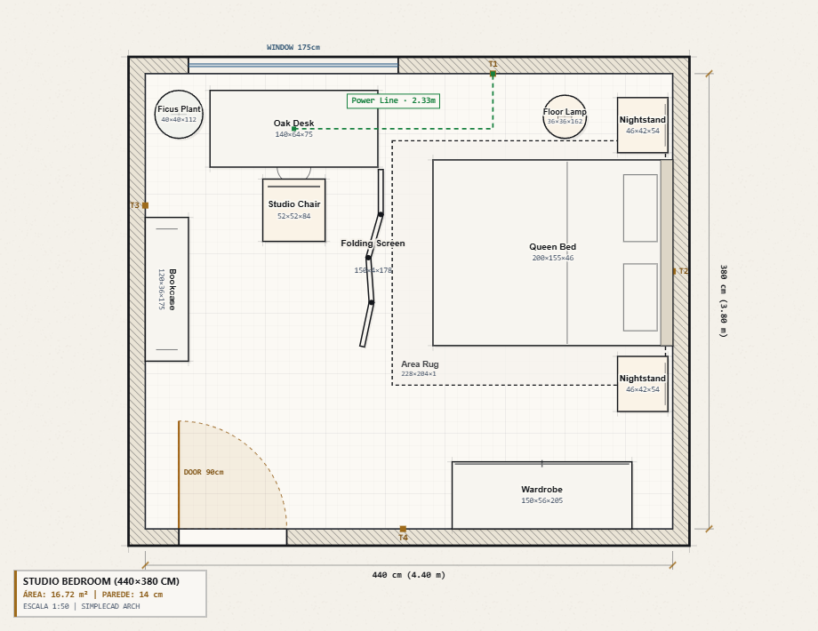
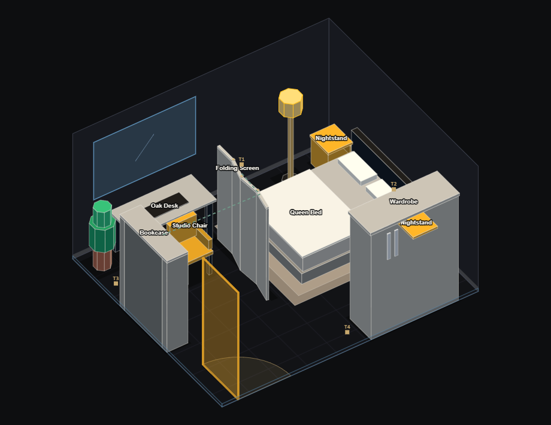

<p align="center">
  
</p>

An offline room planner for working out where your furniture fits before you move it. Draw one rectangular room to scale, compare layouts, and check door swing clearance, cable reach, and architectural **Solid** or **Sketch** views in 2D and 3D.

[Download for Windows](https://github.com/duartelcunha/SimpleCAD/releases/latest) · [Open Web App (Phone & PC)](https://duartelcunha.github.io/SimpleCAD/) · [Run locally](#try-it) · [Build from source](#technical-details)

<p align="center">
  <a href="docs/assets/studio-plan.png"></a>
  <a href="docs/assets/studio-cutaway.png"></a>
</p>

*Studio bedroom, 4.40 × 3.80 m.* The plan shows the door swing and the cable route. Switch between **2D**, **Cabos**, and **3D**—and toggle **Solid** or **Sketch** styling—to inspect layout spacing and sightlines before moving furniture.

## Try it

**Online Web App (Phone, Tablet & PC).** Open [duartelcunha.github.io/SimpleCAD](https://duartelcunha.github.io/SimpleCAD/) in any browser—no installation or technical setup needed. You can add it to your phone’s Home Screen as an offline PWA, take reference photos of furniture directly with your phone camera, and share or carry your floorplan anywhere via a single QR Code (`#p=...` compressed URL).

**Windows (`SimpleCAD.exe` + Live Phone Sync).** The [latest release](https://github.com/duartelcunha/SimpleCAD/releases/latest) ([v1.2.0](https://github.com/duartelcunha/SimpleCAD/releases/tag/v1.2.0)) provides a standalone portable executable (`SimpleCAD.exe`) with no installer required. It uses Microsoft Edge WebView2, embeds all offline web assets at build time, and includes a zero-config **Use on Phone (QR Code)** button in the top toolbar: scan the QR Code with your phone on the same Wi-Fi to edit the room and photograph furniture on your phone with live two-way sync to your PC (or switch to the **4G/5G** tab in the QR dialog to take the room layout anywhere). Because the executable is not signed with a commercial Authenticode certificate, Windows SmartScreen may show a standard unrecognized-app prompt on first launch (*More info* → *Run anyway*).

**Local Browser.** Download or clone this repository, then open `index.html`. The demo bedroom loads ready to edit, and the UI is in Portuguese. To serve it locally:

```powershell
python -m http.server 4173 --bind 127.0.0.1
```

Then open [localhost:4173](http://127.0.0.1:4173).

### Try a desk by the window

1. Under **Adicionar Móvel**, enter `Mesa 120x60x75` and press Enter (120 cm wide, 60 cm deep, 75 cm tall).
2. In **2D**, drag the desk under the window, test a spot near the door swing, and check wall/furniture collision guides.
3. Switch to **3D** and drag to orbit the room, toggle **Solid** / **Sketch** style, and save arrangements with **Guardar disposição**.

The editor saves on this device. Export **JSON** to take an editable copy to another computer or **PNG** to share a drawing. If a storage warning appears, export JSON before closing.

## Technical details

The browser editor uses plain JavaScript and Canvas. The Windows app embeds the same files in a Rust host built with Winit, Wry and WebView2. Projects describe a single rectangular room with sides from 1 to 20 m. The v3 buildings and layers in the design notes are proposals.

<details>
<summary><strong>Build the Windows app</strong></summary>

Install the Rust MSVC toolchain. From the repository root, run

```powershell
cargo build --manifest-path .\native\Cargo.toml --release --locked
Copy-Item .\native\target\release\simplecad.exe .\SimpleCAD.exe -Force
```

Rebuild the standalone executable after changing embedded web assets or icons.

</details>

<details>
<summary><strong>Run the browser tests</strong></summary>

```powershell
npm.cmd ci --ignore-scripts
npm.cmd run test:browser
```

The [Playwright suite](tests/browser-engine.cjs) runs the actual editor headlessly. It checks gestures, geometry, undo, project storage and exports. Use Playwright’s installed Chromium or set `SIMPLECAD_BROWSER_PATH` to an installed Chromium-based browser. Set `SIMPLECAD_PLAYWRIGHT_MODULE` to an absolute module directory to reuse an existing Playwright installation.

The [older checks](tests/verify-all.js) and [benchmarks](benchmarks/) use synthetic fixtures and models. Their timings do not measure browser frame rates.

</details>

[Project status](STATUS.md) · [Contributor notes](AGENTS.md) · [MIT license](LICENSE)
