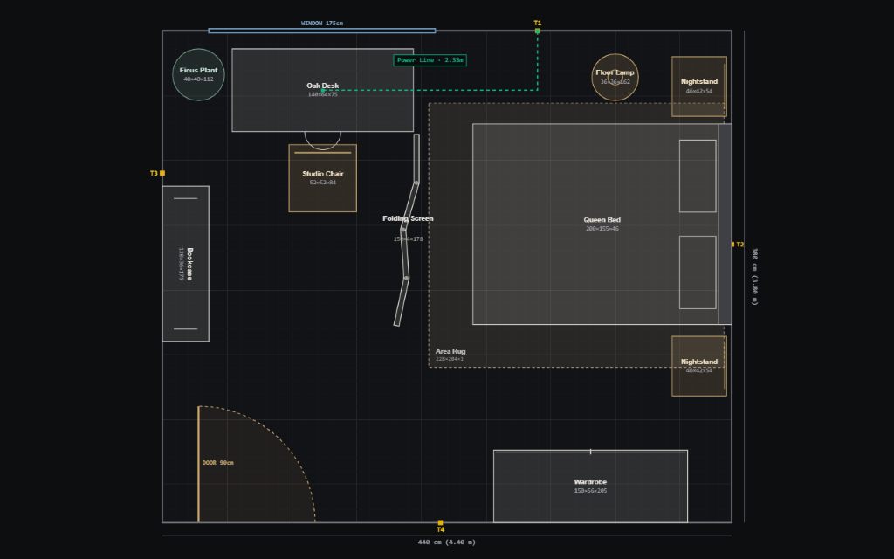
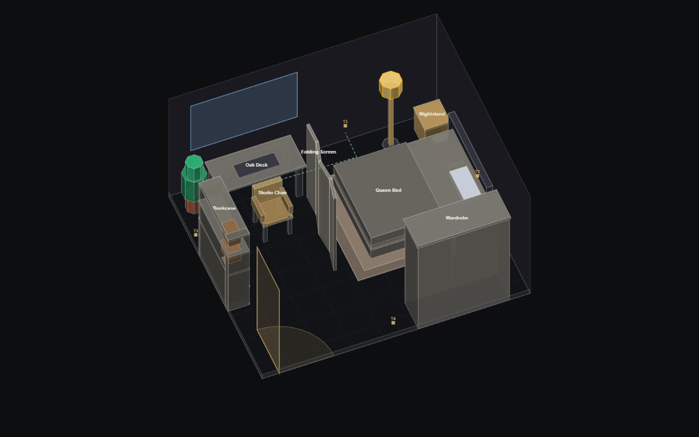

<p align="center">
  
</p>

<p align="center">
  Offline 2D &amp; 3D floorplan planner with centimeter grid snapping, polygon collision detection, cable routing, and a lightweight Win32 WebView2 shell (~766 KB).
</p>

<p align="center">
  <a href="https://github.com/duartelcunha/SimpleCAD/releases/latest">Download Windows (.exe)</a> ·
  <a href="#build">Build from Source</a> ·
  <a href="./LICENSE">MIT License</a>
</p>

| 2D Floorplan | 3D Isometric View |
| :---: | :---: |
|  |  |

## Features

- **2D CAD & SAT Collisions** — Snap to `1 cm` / `5 cm` grids or walls, lock proportions, measure live distances, inspect clearance guides, and detect rotated polygon + door-swing collisions.
- **4-Panel Articulated Dividers** — Drag any of the 5 hinge joints directly in both 2D plan view and 3D orbit with presets (`Straight`, `Zig-Zag`, `L-Corner`, `Arc`, `U-Wrap`).
- **17 Parametric Furniture Archetypes** — Distinct 2D symbols and multi-part 3D geometry, plus an offline text parser (e.g. `Desk 140x65x75`, `Rug 2m x 1.4m`).
- **Cable & Outlet Telemetry** — Route cables directly or along walls, track exact length (`m`) vs threshold limits, and place wall outlets.
- **Portable I/O** — Switch saved room layouts, import/export `.json` project files, or export 2× Retina `.png` plans.

## Run

- **Windows**: Download [`SimpleCAD-Setup.exe`](https://github.com/duartelcunha/SimpleCAD/releases/latest) (installer) or standalone `SimpleCAD.exe` (uses built-in Edge WebView2 on Windows 10/11).
- **Browser**: Serve the repo root statically (`python -m http.server 4173` and open `http://localhost:4173`).

## Build

Requires Rust (`x86_64-pc-windows-msvc`) and optionally NSIS 3.x (`makensis.exe`):

```powershell
cargo build --manifest-path .\native\Cargo.toml --release
Copy-Item .\native\target\release\SimpleCAD.exe .\SimpleCAD.exe -Force

# Optional installer
makensis .\native\installer.nsi
```

## Project Layout

- `index.html`, `styles.css`, `app.js`, `default-room.js` — Offline CAD engine, 2D/3D canvas renderers, and UI.
- `native/` — Rust (`tao` + `wry`) custom-protocol WebView2 host (`src/main.rs`, `build.rs`, `installer.nsi`).
- `icon.svg`, `icon.ico`, `docs/assets/` — `04 Folded Screen` brand assets.
