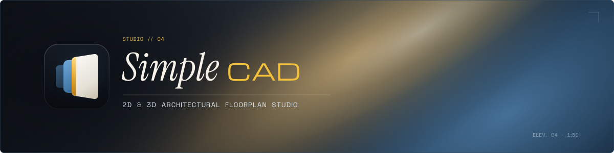

<p align="center">
  
</p>

## What it is

SimpleCAD is an offline room planner for trying furniture arrangements before moving things around. Edit a rectangular room in 2D, inspect it in 3D, check clearances and cable lengths, and save the arrangement as a project file.

The editor supports rotated furniture, articulated dividers, centimeter snapping, doors, windows, outlets, undo/redo, saved layouts, JSON import/export and PNG export. It runs as a static web page or in a small Windows WebView2 shell.

<p align="center">
  
  
</p>

## Try it

For Windows, see the [published releases](https://github.com/duartelcunha/SimpleCAD/releases). Release downloads can lag behind the source branch. The desktop app requires Microsoft Edge WebView2 Runtime.

To try the source, open `index.html` in a browser, or serve the repository locally:

```powershell
python -m http.server 4173 --bind 127.0.0.1
```

Open `http://127.0.0.1:4173`. Try entering `Desk 120x60x75` in the quick-add field, switch between 2D and 3D, and use the JSON dialog to save a portable copy. The editor also saves to the browser's local storage; the desktop app uses its own WebView2 profile.

The current editor has one rectangular room, with each side limited to 100–2000 cm on import. Multi-room buildings, editable wall graphs and layers are proposals. The synthetic v3 projects in `projects/` contain fields the current editor does not preserve; the large example also exceeds its room limits. Keep those fixtures separate from real project backups.

## Technical details

Read [STATUS.md](STATUS.md) for the current handoff and [AGENTS.md](AGENTS.md) for repository guidance. The app uses plain JavaScript, CSS and Canvas; the native shell uses Rust, `tao` and `wry`. The source is available under the [MIT license](LICENSE).

Build on Windows with Rust's MSVC toolchain. NSIS is needed only for the installer:

```powershell
cargo build --manifest-path .\native\Cargo.toml --release --locked
Copy-Item .\native\target\release\simplecad.exe .\SimpleCAD.exe -Force
makensis .\native\installer.nsi
```

Run the existing checks:

```powershell
node --check .\app.js
node --check .\default-room.js
node .\tests\verify-all.js
node .\benchmarks\validate-projects.js
node .\benchmarks\cad-benchmark.js
```

These scripts check source text, documents, synthetic fixtures and separate algorithm prototypes. They do not run the application in a browser. The benchmark uses a simulated canvas, so its throughput figures do not establish browser frame rates or application performance guarantees. UI changes also need real browser checks of editing, undo/redo, project round trips and responsive layouts.

`app.js` contains the editor and renderers, `default-room.js` contains the factory scene and furniture definitions, and `native/` contains the Windows host and installer. The architecture and performance documents in `docs/` describe proposed work; their status notes distinguish that work from the current editor.
